  &nbsp;
  &nbsp;
  &nbsp;
  

Hi, I'm Dan! I've been at Elbit Systems for 4 years. I started in automation, then moved to production support, and in
both I kept writing code to make the work faster.

I've worked on a lot of projects, but the one I'm most proud of is HD Manager, a CRM I designed for my team. I built it
with a colleague and it's in production today.

I'm looking for a **Backend Developer**, **Software Engineer** or **Full Stack Developer** role in the Central District
(Petah Tikva).

 

## Projects

I built it while looking for a job myself. Same search, four sites, too many tabs.

- The LLM must quote the listing word for word for every match or gap. If the quote isn't in the listing, the point is dropped.
- Location, domain and seniority are filtered in plain code. Only the skills match goes to the model.
- Each board sits behind one adapter, so a broken scraper doesn't break the rest. If a board stays down, the search goes on and says which one is missing.

[Live demo](https://job-hunter-zeta-liard.vercel.app) &nbsp;/&nbsp; [Code](https://github.com/danelbaz2/job-hunter) &nbsp;/&nbsp; `Next.js 15` `TypeScript` `PostgreSQL` `Drizzle` `Auth.js` `OpenRouter`

 

I came up with HD Manager and designed its architecture, then built it with a colleague. It's in production.

- **HD Manager:** Flask API with schema validation, React front, MongoDB with version-controlled state, live updates over WebSockets.
- **AI platform:** a company hackathon built an incident platform on top of it, with CRM data, external incident systems, an LLM chatbot and workflow generation. Team of 5, two of us write the code. Demoed to Elbit's CBO.
- **RAG:** I built the ingestion and retrieval part with the same colleague. Chunking, contextual retrieval, embeddings, top-k, reranking, and answers that only use the retrieved sources.

The code belongs to Elbit. I can walk through the design in an interview.

`Python` `Flask` `React` `MongoDB` `WebSockets` `Docker`

 

**Also:** [Concurrent Retail System](https://github.com/danelbaz2/java-store-network-system), a Java client-server system from university. One thread per client over TCP, shared inventory kept consistent with synchronization, JUnit tests.

## Stack

## Experience

- **2026 to now:** Backend and AI development, Elbit Systems
- **2025 to now:** Application Support Engineer, Tier 3, Elbit Systems. Production incidents across Java and Python microservices on OpenShift, traced through code, logs, Git history and MongoDB/SQL data.
- **2022 to 2025:** Automation and Infrastructure, Elbit Systems. PowerShell and Ansible automation that took server deployment from 4 days to about 6 hours.
- **2020 to 2022:** Network administrator, IDF 98th Division. IDF Excellence Award.

**Education:** B.Sc. Computer Science, HIT, 2026. GPA 95, Dean's List. Done while working full-time.

Hebrew and French natively, English at work.

 

Thanks for stopping by. You can reach me at <a href="mailto:danelbaz3@gmail.com">danelbaz3@gmail.com</a>.

